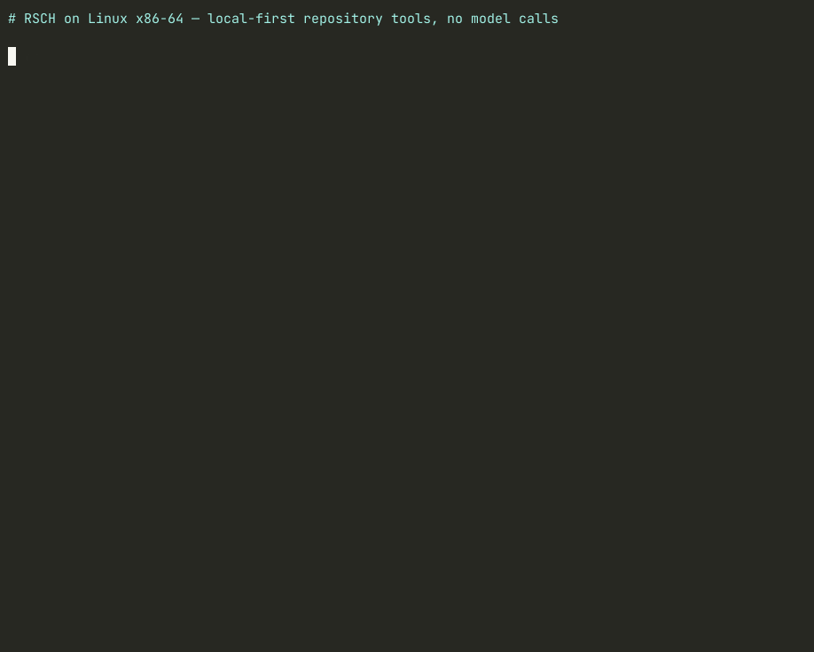
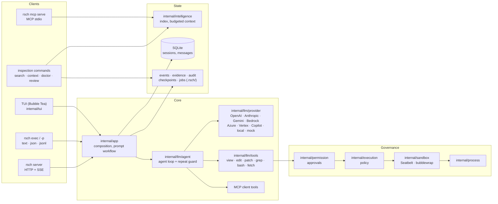

# RSCH CLI

**Fewer tokens, more done: a local-first AI coding agent for the terminal that sends the model only the context it needs.**

RSCH aims to run entirely on your machine, with Ollama or another local OpenAI-compatible server as the
model and no cloud service or API key required. Hosted providers (Anthropic, OpenAI, Gemini, and others)
are optional and bring-your-own-key. Every action is approval-gated.



<sub>Recorded on Linux x86-64 with the real binary built from this repository (`docs/assets/rsch-demo-linux.gif`). None of the commands shown call a model. Not recorded on macOS.</sub>

## Token optimisation: what works today and what is planned

The goal is always-on, automatic token optimisation. Today it is only partly there:

| Technique | Status (verified 2026-11-24 on Linux) |
| --- | --- |
| Token-budgeted context: `rsch context "<query>" --budget N` returns ranked file and line matches with provenance inside an approximate budget | **Works.** In the demo, a 400-token budget used 395 tokens across 3 selected files |
| Smart file and line selection: `rsch search`, plus `get_context` and `search_repository` over MCP | **Works** for search and context retrieval. Not yet wired automatically into the agent loop |
| Trimming tool output | **Partial.** Inherited from upstream: shell output is capped at 30,000 characters. No smarter trimming |
| Summarising long histories (auto-compact at 95% of the context window) | **Partial.** Inherited from upstream and wired into the TUI only. Not verified here |
| Prompt and context compression, deduplication, caching of repeated context | **Planned.** See [roadmap item 1](docs/roadmap.md) |
| Measured token savings | **None yet.** A benchmark that runs the same tasks with the optimiser on and off is planned. Only measured numbers will be published |

Token counts in `rsch context` are approximate: about 4 bytes per token (`approximateTokens` in `internal/intelligence`), not a model tokenizer.

**Defaults today (local first):** with no model configured, RSCH probes Ollama (`http://localhost:11434/v1`)
and then LM Studio (`http://localhost:1234/v1`) with a 750 ms timeout and uses the first chat model it finds,
skipping embedding models. `LOCAL_ENDPOINT` picks a server explicitly, and an explicit `agents.coder.model`
always wins. A hosted provider is used only when it is configured that way or when no local server answers.
`rsch exec` prints the provider in use to stderr (for example
`rsch: using local (auto-detected http://localhost:11434/v1), model llama3.2-3b-16k:latest`), and `rsch doctor`
reports it as `provider-in-use`. Set `RSCH_NO_LOCAL_DETECT=1` to turn probing off.

## Built on OpenCode, and what is new

RSCH is a solo project by Ram Surya Chelluboyina, built on top of
**[opencode-ai/opencode](https://github.com/opencode-ai/opencode)**, the original Go implementation of OpenCode by Kujtim Hoxha
(MIT). Upstream was archived in September 2025, and its authors continued the work as
[Charm Crush](https://github.com/charmbracelet/crush). RSCH is **not** the TypeScript
`sst/opencode` (now `anomalyco/opencode`), and it is not affiliated with or endorsed by either team.
See [NOTICE](NOTICE) for the attribution details.

**From upstream (commit `73ee493`, 2025-09-17):** the Bubble Tea TUI, the provider adapters (OpenAI,
Anthropic, Gemini, Bedrock, Groq, Azure, Copilot, OpenRouter, local), the core file, grep and bash tools, the LSP
client, the SQLite session store, custom commands, and the MCP *client*.

**Added in RSCH** (measured with `git diff --no-index` against that upstream commit):

| | Upstream | RSCH |
| --- | --- | --- |
| Go lines (incl. tests) | ~42k | ~112k |
| `_test.go` files | 4 | 202 |
| CLI subcommands | root command only | 58 (`rsch --help`) |
| Files changed vs upstream | | 524 (+77,100 / −4,604 lines; 248 new files) |

Main additions:

- **Governed execution.** Permission policy, explicit approvals (non-interactive mode denies by default
  unless `--auto-approve` is given), workspace boundaries, secret redaction, and OS sandbox adapters (macOS
  `sandbox-exec`/Seatbelt and Linux bubblewrap).
- **Repository intelligence for token efficiency.** `rsch search` and `rsch context --budget N` return
  ranked, line-level matches with provenance (file, line and content hash) inside an approximate token budget,
  so an agent can load only what it needs.
- **MCP server mode.** `rsch mcp serve` exposes `search_repository`, `get_context`, and
  `explain_instructions` over stdio to any MCP client. These tools are read-only and make no model calls.
- **Headless and automation.** `rsch exec` with `text`, `json` or versioned `jsonl` output, an optional
  workspace-local JSON Schema for the final answer (`--output-schema`), and an HTTP/SSE service (`rsch server`).
- **Workflow state and safety nets.** Approval-gated checkpoints and rewind (`rsch checkpoint`,
  `rsch rewind`), isolated Git experiments (`rsch experiment`, `rsch fork`), persisted background jobs
  (`rsch run`, `rsch jobs`, `rsch stop`), specs with traceability (`rsch spec`), evidence and audit
  records (`rsch evidence`, `rsch audit`, `rsch why`), and an independent read-only review command (`rsch review`).
- **Project resources.** Repository-defined agents (`rsch agent`), skills (`rsch skill`), plugins
  (`rsch plugin`), scoped memory (`rsch memory`), and AGENTS.md hierarchy resolution
  (`rsch instructions explain`).
- **Operability.** `rsch doctor` runs 22 read-only capability checks, and `rsch cost` shows per-session
  token and cost totals.

## Architecture



## Quickstart

RSCH is built from source. **No release binaries are published yet** (see [Honest limits](#honest-limits)).

### macOS (Apple silicon or Intel)

```bash
# Go 1.26 or newer (go.mod declares go 1.26.0)
brew install go git

git clone https://github.com/RamSuryaCH/rsch-cli.git
cd rsch-cli
go build -trimpath -o rsch .
./rsch --version
./rsch doctor            # read-only capability checks; reports the Seatbelt sandbox if available
```

> These macOS steps follow standard Go tooling but **have not been run on a Mac by this README's author**.
> The commands and output shown here were verified on Linux x86-64.

### Linux

```bash
# Install Go 1.26+ from https://go.dev/dl/ or your distro, plus git (and optionally bubblewrap)
git clone https://github.com/RamSuryaCH/rsch-cli.git
cd rsch-cli
go build -trimpath -o rsch .
./rsch doctor
```

### First run

```bash
# No model needed: repository tools
./rsch search "func main" --limit 5
./rsch context "how are background jobs stopped" --budget 800

# Local model through Ollama, with no API key and no config: RSCH finds it on localhost:11434
ollama serve &                       # if it is not already running
./rsch doctor                        # provider-in-use: ok (local (auto-detected http://localhost:11434/v1), ...)
./rsch                               # interactive TUI
# Elsewhere? Point at it explicitly (OpenAI-compatible API, so include /v1)
export LOCAL_ENDPOINT=http://gpu-box:11434/v1

# Optional: a hosted provider (bring your own key)
export ANTHROPIC_API_KEY=...        # or OPENAI_API_KEY, GEMINI_API_KEY, ...
./rsch exec "Summarize this repository" -q
```

For local models, the server's context window must hold RSCH's agent prompt and tool definitions, which come
to about 10k tokens. Ollama's default is 4096. See [docs/usage.md](docs/usage.md#using-a-self-hosted-model-provider).

### Use RSCH from an MCP client

```bash
# Inspect with the official MCP Inspector CLI
npx -y @modelcontextprotocol/inspector --cli ./rsch mcp serve --method tools/list
```

```jsonc
// Any MCP client that launches stdio servers, for example:
{
  "mcpServers": {
    "rsch": { "command": "/path/to/rsch", "args": ["mcp", "serve", "--cwd", "/path/to/repo"] }
  }
}
```

## Development

```bash
go vet ./...
go test ./...          # 84 packages pass on Linux x86-64 (Go 1.27.3) as of 2026-11-24
```

Run the tests with `LOCAL_ENDPOINT` unset. Discovered local models are added to the generated config schema,
so `cmd/schema`'s snapshot test fails when that variable points at a live server.
Repository working rules for humans and agents are in [AGENTS.md](AGENTS.md).

## Honest limits

- **No releases.** No release has been published. The install script, Homebrew, AUR and package
  instructions that used to be here were removed because they pointed at a repository that does not exist.
  `.goreleaser.yml` and `install` are kept for future use.
- **CI does not run.** `.github/workflows/` exists, but GitHub Actions is not running for this account, so
  there are no CI badges and none should be inferred.
- **macOS is untested here.** The Seatbelt sandbox and its darwin-only tests (`seatbelt_darwin_test.go`)
  cannot run on the Linux machine used for this work. The bubblewrap backend is detected on Linux by
  `rsch doctor`.
- **Small local models loop.** With `llama3.2:3b` (16k context) through Ollama, the agent reaches the model
  and issues tool calls, but the model repeats the same call. RSCH's repeat guard stops the run after 3
  identical requests. No end-to-end coding task has been demonstrated with a local model yet.
- **Copilot provider (inherited, experimental, opt-in).** It is used only with an explicitly provided token
  (`RSCH_COPILOT_TOKEN` or `providers.copilot.apiKey`). RSCH no longer reads other tools' stored Copilot
  credentials or treats `GITHUB_TOKEN` as consent. GitHub officially supports Copilot sign-in only for
  partners such as OpenCode, so treat this path as unsupported. See
  [docs/research.md](docs/research.md#signing-in-with-an-existing-ai-subscription).
- **The module path is still upstream's.** It is `github.com/opencode-ai/opencode`, so
  `go install github.com/RamSuryaCH/rsch-cli@latest` does not work. Build from a clone.
- **Work in progress.** Many workflow features are marked `implementing` in RSCH's own feature registry. See
  [docs/roadmap.md](docs/roadmap.md) for the status of each, and [docs/research.md](docs/research.md) for a
  comparison with Codex CLI, OpenCode and Grok Build.

## More documentation

- [docs/usage.md](docs/usage.md): configuration, providers, keyboard shortcuts, custom commands, MCP client, LSP
- [docs/architecture/](docs/architecture/): current state, runtime boundaries, and target state
- [docs/research.md](docs/research.md): feature matrix and developer pain points
- [docs/roadmap.md](docs/roadmap.md): prioritised roadmap with honest status

## Acknowledgments

- [opencode-ai/opencode](https://github.com/opencode-ai/opencode) by Kujtim Hoxha and contributors, the upstream this project builds on.
- [@isaacphi](https://github.com/isaacphi): [mcp-language-server](https://github.com/isaacphi/mcp-language-server), the basis of the upstream LSP client.
- [@adamdottv](https://github.com/adamdottv): upstream design direction and UI/UX.
- The ideas of approval-gated execution and a Seatbelt-confined workspace were inspired by
  [openai/codex](https://github.com/openai/codex). No Codex source code is included.

## License

MIT. See [LICENSE](LICENSE) (upstream copyright retained, plus a copyright line for RSCH's modifications)
and [NOTICE](NOTICE).
